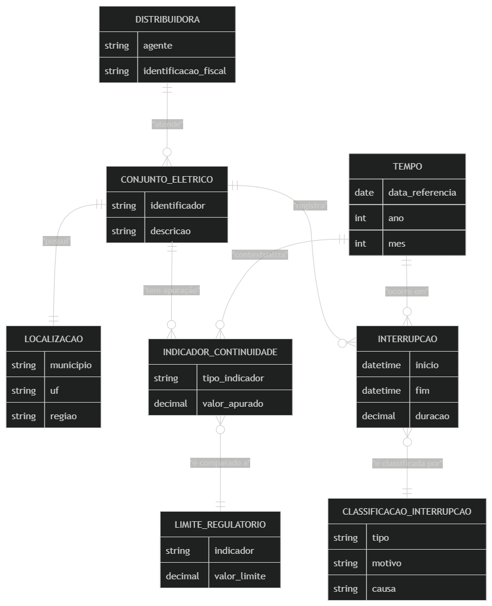

# Modelo Estrela (Star Schema)

Este documento descreve as tabelas dimensão e fato, além do modelo dimensional (Star Schema).

## Dimensões

- **dim_data:** Calendário contínuo no nível diário (2021–2025)

- **dim_distribuidora:** Concessionárias de distribuição de energia elétrica (identificadas por CNPJ e sigla)

- **dim_conjunto:** Conjuntos elétricos de unidades consumidoras, distribuidora responsável e localização regional

- **dim_indicador:** Indicadores de qualidade de continuidade do serviço (DEC e FEC)

- **dim_tipo_interrupcao:** Classificação operacional do evento (Programada vs. Não Programada)

- **dim_motivo_interrupcao:** Motivos regulatórios de expurgo da ANEEL (PRODIST Módulo 8)

- **dim_causa_interrupcao:** Classificação padronizada da origem, programação, grupo e causa detalhada da interrupção

## Fatos

- **fato_continuidade:** Indicadores mensais apurados de DEC e FEC confrontados com os limites regulatórios (grão mensal por conjunto e indicador)

- **fato_causa_mensal:** Agregação mensal por conjunto, tipo, motivo e causa, com volume de interrupções, duração, tensão, unidades afetadas e contribuições estimadas ao DEC/FEC

> [!WARNING]
> Não relacione fatos diretamente entre si. Use dimensões conformadas com cardinalidade 1:\*.

---

## Modelo Conceitual

O modelo conceitual representa as entidades do domínio de distribuição de energia elétrica e suas relações de negócio.

</img>

---

## Star Schema

O Star Schema é a implementação física do modelo conceitual na camada `data/processed`. Ele organiza o modelo em dimensões e fatos relacionados por chaves primárias e estrangeiras, permitindo análises por tempo, distribuidora, conjunto, indicador, tipo, motivo e causa de interrupção.

</img>